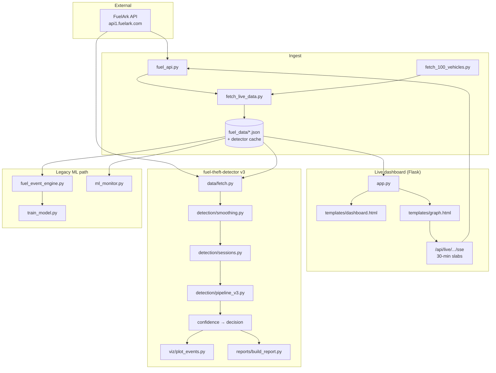
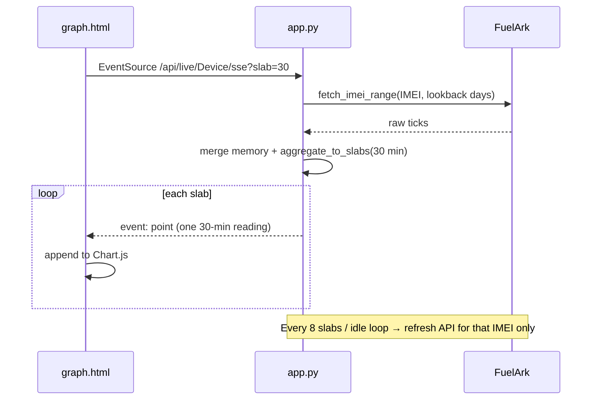
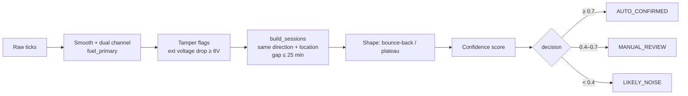

# Fuel ML / AI Automation — Complete Project Architecture

Single reference for **structure**, **links**, **data flow**, and **detection / live-streaming logic**.

---

## 1. What this repo contains

Three complementary systems live in one workspace:

| System | Purpose | Entry |
|--------|---------|--------|
| **Fuelark UI** (`frontend/` + `backend/`) | Fleet list/map + Live Map multi-series chart (Fuelark-style) | `python3 -m backend.app` + `cd frontend && npm run dev` |
| **Legacy dashboard** (`legacy/templates/`) | Older Flask HTML pages. **Not served by any current route** — kept for reference only | — |
| **Theft/fill detector v3** (`fuel-theft-detector/`) | Session-based drain/fill detection + reports/plots (CLI) | `detector_v3.py` / `cli.py` |

This is the single surviving document; the per-package READMEs and specs it used to
link to were consolidated into it.

## Quick start

```bash
pip install -r requirements.txt

python3 -m backend.app        # API on :5001

cd frontend && npm install && npm run dev   # UI on :5173, proxies /api to :5001
```

The repository path contains a `:`, which breaks the `npx`/`vite` shims. Use the
`package.json` scripts, or call the binary directly:

```bash
node ./node_modules/vite/bin/vite.js --host 127.0.0.1 --port 5173
```

`npm run build` regenerates `frontend/dist/`, which `backend/app.py` serves when present.

## Measured status

Vehicle identity resolves once, by IMEI, via
`tools/build_ground_truth.py` → `fuel_data/ground_truth/theft_cases.csv` and
`tools/build_vehicle_assignments.py`. Matching is plate/IMEI-exact; cases that cannot
resolve to exactly one IMEI are reported `UNRESOLVED` and excluded from recall.

```bash
cd fuel-theft-detector
python3 tools/evaluate_known_thefts.py --data ../fuel_data/june_2026_data.json
```

| Metric | Value |
|---|---|
| Strict recall (quantity within tolerance) | 7 / 13 = 53.8 % |
| Lenient recall (also counts "covering" detections) | 11 / 13 = 84.6 % |
| Coverage (cases evaluable at all) | 13 / 82 = 16 % |
| Hits by tier | 10 AUTO_CONFIRMED, 1 MANUAL_REVIEW |

Two numbers that are easy to confuse: the model's **98 % training accuracy** is an
offline holdout score measuring how well it reproduces the rule engine's own labels —
not a runtime filter and not a field accuracy figure. **Precision is not measured
anywhere**, as the repo holds no confirmed non-theft labels. Recall is the only
validated metric today.

## Tests

```bash
cd fuel-theft-detector && python3 -m unittest discover -s tests   # 12 detection tests
PYTHONPATH=. python3 tests/test_theft_event_pipeline.py
```

Two root tests are known-failing, both pre-existing: `test_analyze_fuel_data.py`
asserts `is_short_window_event(5.0, 8.0, "filling")` is true but the implementation
uses `change > 5`, so the boundary fails; and `test_dashboard_reports.py` imports
`device_data_dict` from `app.py`, which the current shim does not export.

## Why legacy/ is quarantined

`legacy/` is the v1 tick-level pipeline, superseded by `fuel-theft-detector/` v3. It is
retained for reference, not production. Its scripts use **CWD-relative** paths, so run
them from the repository root (`python3 legacy/train_model.py`), never from inside
`legacy/`.

Its output is not trustworthy: `fuel_data/ml_alerts.json` holds **181,547 alerts** for
June against 82 reported thefts, median magnitude **0.17 L**, with 150,084 below 1 L —
far under the 2 L noise floor v3 uses. The cause is in `fuel_event_engine.py`:
`classify_row()` fires on EDC sensor counts alone with no fuel-volume requirement, and
the only post-filter is an `AND`, so a −13 EDC / −0.51 L tick survives as a "theft".
The v1 model also suffers label leakage — `is_slope`, `fuel_net_15m`, `edc_net_15m`,
`speed_max_15m` and `movement_15m` are both features and the exact rule inputs.

---

## 2. High-level architecture



---

## 3. Repository map (links)

### Fuelark UI — `frontend/` + `backend/`

| Path | Role |
|------|------|
| [backend/app.py](../backend/app.py) | Flask API entry (CORS, health, blueprints) |
| [backend/services/metrics.py](../backend/services/metrics.py) | Fuelark summary cards (ltr/h, haversine distance, filling/theft) |
| [backend/services/slabs.py](../backend/services/slabs.py) | Optional 30‑min slabs + downsample |
| [backend/services/data_store.py](../backend/services/data_store.py) | Load stamped June/live JSON into memory |
| [backend/api/routes_fleet.py](../backend/api/routes_fleet.py) | `/api/fleet/summary`, `/api/fleet/devices` |
| [backend/api/routes_devices.py](../backend/api/routes_devices.py) | `/api/devices/<name>/summary`, `/series` |
| [backend/api/routes_live.py](../backend/api/routes_live.py) | Live JSON + SSE (multi-series points) |
| [frontend/src/pages/FleetDashboard.jsx](../frontend/src/pages/FleetDashboard.jsx) | Vehicle cards + map + fleet KPIs |
| [frontend/src/pages/LiveMap.jsx](../frontend/src/pages/LiveMap.jsx) | Summary cards + From/To + Live Chart/Table |
| [frontend/src/components/DeviceChart.jsx](../frontend/src/components/DeviceChart.jsx) | Highcharts multi-series (Fuel/EDC/Ignition/…) |

**Run:**

```bash
python3 -m backend.app          # http://127.0.0.1:5001
cd frontend && npm run dev      # http://127.0.0.1:5173 (proxies /api)
```

**Live Chart series:** Fuel Level, Fuel Level EDC, Ignition, Movement, Speed, Power Ex, Power In.  
Default chart grain is **downsampled raw ticks** (not forced 30‑min slabs). Pass `?slab=30` for slab analysis.

### Root — live monitoring & legacy pipeline

| Path | Role |
|------|------|
| [app.py](../app.py) | Compatibility shim only — re-exports `backend.app`. The server lives in `backend/` |
| [templates/dashboard.html](../legacy/templates/dashboard.html) | Main ops dashboard + live stream button |
| [templates/graph.html](../legacy/templates/graph.html) | Dedicated live graph (auto-starts SSE) |
| [fuel_api.py](../fuel_api.py) | Shared FuelArk HTTP client (API key / bearer) |
| [fetch_live_data.py](../fetch_live_data.py) | Batch / stream fetch → `fuel_data/live_fuel_data.json` |
| [fetch_100_vehicles.py](../fetch_100_vehicles.py) | Fleet IMEI list (~100 devices) |
| [tools/fetch_and_preprocess_fleet.py](../tools/fetch_and_preprocess_fleet.py) | Fetch June range for fleet IMEIs, stamp `imei`, normalize CSV |
| [tools/may_fuel_theft_report.py](../tools/may_fuel_theft_report.py) | May 2026 fleet theft report (fetch + v3 detect) |
| [tools/train_session_classifier.py](../tools/train_session_classifier.py) | Session-level RF / IsolationForest training on June |
| [legacy/automate.py](../legacy/automate.py) | Pipeline orchestrator (`fetch` / `train` / `dashboard` / `watch`) |
| [legacy/analyze_fuel_data.py](../legacy/analyze_fuel_data.py) | Rule-based event CSV/JSON (older path) |
| [legacy/fuel_event_engine.py](../legacy/fuel_event_engine.py) | Domain features + labeling for legacy tick ML |
| [legacy/train_model.py](../legacy/train_model.py) | Legacy RandomForest on historical tick features |
| [legacy/ml_monitor.py](../legacy/ml_monitor.py) | ML alerts / watch loop |
| [legacy/stream_and_train.py](../legacy/stream_and_train.py) | Fetch then train helper |
| [parse_user_theft_cases.py](../parse_user_theft_cases.py) | Known theft spreadsheet → JSON labels |
| [fuel_data/](../fuel_data/) | Cached telemetry, events, alerts |
| [tests/](../tests/) | Dashboard / analyze / theft pipeline tests |

### `fuel-theft-detector/` — v3 detection product

| Path | Role |
|------|------|
| [detector_v3.py](../fuel-theft-detector/detector_v3.py) | Thin v3 CLI (session pipeline) |
| [cli.py](../fuel-theft-detector/cli.py) | `run` / `plot` / `report` |
| [config.py](../fuel-theft-detector/config.py) | Thresholds, burn rates, env secrets |
| [data/fetch.py](../fuel-theft-detector/data/fetch.py) | Normalize + cache FuelArk pulls |
| [data/vehicle_assignments.py](../fuel-theft-detector/data/vehicle_assignments.py) | Time-aware IMEI → vehicle |
| [detection/smoothing.py](../fuel-theft-detector/detection/smoothing.py) | Rolling median + dual-channel |
| [detection/baseline.py](../fuel-theft-detector/detection/baseline.py) | Expected burn residual (legacy tick path) |
| [detection/sessions.py](../fuel-theft-detector/detection/sessions.py) | **Session consolidation** (v3 core) |
| [detection/tamper.py](../fuel-theft-detector/detection/tamper.py) | Voltage-drop tamper |
| [detection/pipeline_v3.py](../fuel-theft-detector/detection/pipeline_v3.py) | End-to-end session score |
| [detection/events.py](../fuel-theft-detector/detection/events.py) | Legacy per-tick candidates |
| [detection/scoring.py](../fuel-theft-detector/detection/scoring.py) | Confidence tiers + `run_detection()` |
| [viz/plot_events.py](../fuel-theft-detector/viz/plot_events.py) | Plotly HTML + PNG |
| [reports/build_report.py](../fuel-theft-detector/reports/build_report.py) | CSV/HTML + safe rollups |
| [tests/test_detection.py](../fuel-theft-detector/tests/test_detection.py) | Synthetic unit tests |

---

## 4. Runtime links (local)

| URL | What you see |
|-----|----------------|
| http://127.0.0.1:5001/ | Built React app when `frontend/dist` exists, else a JSON banner |
| http://127.0.0.1:5001/api/health | Device / IMEI-map counts |
| http://127.0.0.1:5001/api/devices | Device list (live-mapped first) |
| http://127.0.0.1:5001/api/device/`<name>`?slab=30 | Historical points as 30‑min slabs |
| http://127.0.0.1:5001/api/devices/`<name>`/series | Multi-field chart series |
| http://127.0.0.1:5001/api/devices/`<name>`/events | Fill / theft events (raw ticks, never slabbed) |
| http://127.0.0.1:5001/api/live/`<name>` | JSON live poll (+ optional FuelArk fetch) |
| http://127.0.0.1:5001/api/live/`<name>`/sse?slab=30 | **SSE stream** of slab points |
| http://127.0.0.1:5001/api/live/status | IMEI map / device counts |
| http://127.0.0.1:5001/api/live/resolve-map | One-time fleet IMEI discovery |
| http://127.0.0.1:5001/api/fleet/summary | Fleet KPI roll-up |
| http://127.0.0.1:5001/api/alerts/latest | Most recent 30-minute digest |
| http://127.0.0.1:5001/api/alerts/days | Days with alert CSVs on disk |
| http://127.0.0.1:5001/api/alerts/download/`<day>` | Day-wise alert CSV export |
| http://127.0.0.1:5001/api/alerts/run | POST — force one pipeline cycle |
| http://127.0.0.1:5001/api/ml_alerts | Legacy v1 ML alert table feed |

The UI is served by Vite in development (`:5173`, proxying `/api`), so the backend's
own `/` matters only for a built `frontend/dist`.

```bash
python3 -m backend.app     # or: python3 app.py (shim)
```

---

## 5. External API (FuelArk)

```
GET https://api1.fuelark.com/api/FuelConsumption/DeviceFuelConsumption
    ?IMEI=...&fromdate=YYYY-MM-DD 00:00:00&todate=YYYY-MM-DD 23:59:59
Header: x-api-key: $FUELARK_API_KEY
```

Full field mapping: see §3 below and [data/fetch.py](../fuel-theft-detector/data/fetch.py).

### How many API hits in live streaming?

| Mode | Hits |
|------|------|
| Stream **one** mapped vehicle, ~2 calendar days lookback | **~2–3 calls per refresh** (1 call per day × days) |
| SSE refresh cadence | Start + every **8** slabs + ~every **15s** while idle |
| First-time `/api/live/resolve-map` | **~100 IMEIs × days** (fleet list) — rare |

Only **one API type** is used for telemetry. Live graph does **not** call 100 vehicles every second.

---

## 6. Live streaming logic (dashboard)



### Key logic pieces in `app.py`

1. **Load** `june_2026_data.json` (if present) + merge `live_fuel_data.json`  
2. **`aggregate_to_slabs(points, 30)`** — one analysis point per `:00` / `:30` window (last reading in slab)  
3. **`_fetch_live_for_device`** — resolve device → IMEI, pull FuelArk, merge  
4. **SSE** — push slabs to the browser; keep polling for new telemetry  

### Graph UI (`templates/graph.html`)

- Auto-starts LIVE on load  
- Uses `EventSource` against SSE  
- X-axis step = **30 minutes**  
- Shows fuel, ignition, streamed slab count  

---

## 7. Detector v3 logic (theft / fill)



### Why sessions (v3 core fix)

Per-tick classification turned **one continuous drain** into ~20 rows.  
v3 groups continuous **same-direction**, **same-location** (≤50 m) ticks with gap ≤25 min, then computes:

```
magnitude = |end_level − start_level|
```

…from boundary fuel levels (not unreliable per-tick “fuel change” fields).

### Confidence signals (simplified)

| Signal | Effect |
|--------|--------|
| Magnitude ≥ 5 L | Strong positive |
| Magnitude 2–5 L | Weak / needs shape |
| No bounce-back | Positive |
| Plateau stable | Positive |
| Drain + ignition off | Positive |
| Tamper voltage drop before drain | Strong positive |
| Channel disagreement / low internal V | Penalty |

### Stationary gate

Truly parked only if **speed == 0 AND movement == false** (either alone is insufficient),
and it must hold for *every* tick of the session. State is read from the session's own
ticks — `start_idx` is the last reading *before* the level moved, so sampling it
describes the vehicle as it was beforehand and reads a park-transition drain as
"driving".

### Expected burn

Subtracted from engine-ON drains, integrated **per interval** at the rate that interval
was in (moving → running rate, idling → idle rate), capped at 60 min per gap. Billing a
whole session at the running rate because one tick showed motion let a single stray GPS
sample inside a two-hour parked drain subtract 7 L from a real theft.

### Vehicle assignment

IMEI ↔ vehicle is **time-aware** (`valid_from` / `valid_to`). Never a static IMEI→name map only — devices can move between vehicles.

---

## 7b. The 30-minute alert gate

Detection finds events; [`backend/services/alerts.py`](../backend/services/alerts.py)
decides which a human is told about. One chain every 30 min
([`pipeline.py`](../backend/services/pipeline.py)): fetch → detect → confirm → day CSV
+ digest. Running on a cadence is what makes waiting possible — an event is held ~25 min
to see whether the fuel comes back.

Each check, in order. `hold` is reconsidered next cycle; `suppress` is recorded with its
reason in `<day>_filtered.csv` rather than silently dropped:

| # | Check | Why |
|---|---|---|
| 0 | `VERIFIED` bypasses everything | Human-confirmed; truth did not come from this pipeline |
| 1 | Device still reporting | Silence is not evidence of anything |
| 2 | Younger than settle → **hold** | Too early to judge |
| 3 | Max telemetry gap inside the window | The change has to have been *observed* |
| 4 | Fills release here | A phantom fill costs nothing |
| 5 | Voltage-coupling margin | The reading tracks the rail; up to 70 L of phantom swing |
| 6 | Persistence (drop still missing, crediting refuels) | 68 % of >2 L crank dips recover |
| 7 | Crank transient floor | Ignition OFF→ON near the start |
| 8 | **Gradient / park settling** | See below |

Identity in the ledger is `(device, type, start-minute)` — **not** volume. A drain still
growing across cycles keeps its start time while its magnitude changes, so a
volume-bearing key minted a new identity every 30 min and re-alerted the same theft.

### Parking on a gradient

Fuel settles away from the sender when a vehicle stops on a slope: the level steps down
within a minute or two of ignition OFF, holds flat while parked, and returns only when
it drives off — hours later, long past the settle window, so the persistence test cannot
separate it from theft. Measured: a 15 L step on parking, flat for 3 h, fully restored on
departure, released as `AUTO_CONFIRMED` theft plus a phantom 15 L fill.

**There is no tilt signal to use.** The Teltonika axis IDs (`iO_17`/`iO_18`/`iO_19` =
Axis X/Y/Z) exist in the API schema but are never populated — 0 non-empty samples across
46 device-days — and `altitude` is ground elevation, not vehicle attitude. So the
discriminator is behavioural: **stolen fuel does not come back when you drive away.**

Two layers, both env-tunable in [`backend/config.py`](../backend/config.py):

- **Alert gate.** A drain starting within `PARK_SETTLE_MINUTES` of the vehicle coming to
  rest is held until it moves again. If the level is restored after departure →
  suppressed as `park_settling_restored_to_*`. If it never moves, the hold expires at
  `PARK_ARTIFACT_MAX_HOLD_MINUTES` and it is reported. It fails toward reporting.

  "Came to rest" and "moved again" are judged from **motion, not ignition**: speed, the
  movement IOs (`iO_2`/`iO_6`), and displacement between consecutive GPS fixes
  (`MOTION_DISPLACEMENT_M`). An ignition-only test silently excluded every
  stuck-`iO_1` device — they never emit an ON→OFF edge, so they got no gradient
  protection at all — and would have read a stuck-*on* device as departing immediately,
  discarding the hold. The ignition edge is still honoured as an additional trigger, so
  a vehicle switched off while already stationary is covered too. Displacement is what
  catches movement when speed reports 0 across sparse polls.
- **Retroactive pairing** (`_suppress_tilt_settling` in `detection.py`). A THEFT then
  FILL of similar volume at the **same place** within `SETTLING_MATCH_HOURS` cancels
  both. Matched on location because settling reverses exactly where it began, while a
  theft followed by a genuine refuel happens at a pump somewhere else. Missing
  coordinates mean no cancellation.

The cost, stated plainly: a theft in the first few minutes after parking can be delayed
by up to `PARK_ARTIFACT_MAX_HOLD_MINUTES` (default 120), and a theft followed by a
same-location refuel of within 25 % of the stolen volume inside 24 h would be cancelled.

---

## 8. Data stores

| File / dir | Contents |
|------------|----------|
| `fuel_data/fleet_imeis.txt` | Canonical fleet IMEIs (~100–101) |
| `fuel_data/june_2026_data.json` | June 2026 dump **with `imei` stamped** (dashboard / training seed) |
| `fuel_data/may_2026_data.json` | May 2026 dump (~7.47M pts) used for May theft report |
| `fuel_data/june_2026_imei_data.json` | Same stamped June pull (backup copy) |
| `fuel_data/june_2026_normalized.csv` | Detector-ready normalized rows (`normalize_records`) |
| `fuel_data/live_fuel_data.json` | Recent live multi-IMEI pull |
| `fuel_data/device_imei_map.json` | Fuelark display name → IMEI for live graph |
| `fuel_data/device_display_names.json` | short API name / IMEI → Vehicle Summary display name |
| `fuel_data/fuelark_vehicle_roster.json` | 98 names from Fuelark Vehicle Summary export |
| `fuel_data/fuel_events.json` | Rule-detected events (legacy analyze) |
| `fuel_data/ml_alerts.json` | ML monitor alerts |
| `fuel_data/verified_theft_events.json` | Human/spreadsheet verified cases (82 June thefts) |
| `models/fuel_session_rf.pkl` | Session-level RandomForest (`theft/fill/sensor_fault/noise`) |
| `models/june_session_training_rows.csv` | Labeled session feature rows used for training |
| `models/june_daily_residual_anomalies.csv` | IsolationForest daily residual flags |
| `fuel-theft-detector/data/cache/` | Per-IMEI/day parquet/CSV cache |
| `fuel-theft-detector/data/vehicle_assignments.csv` | Assignment history |
| `fuel-theft-detector/output/plots/` | Event charts |
| `fuel-theft-detector/output/reports/` | CSV + HTML reports (incl. May theft report) |

### 8.1 June 2026 stamped dump (verified + merge)

Fetched via [tools/fetch_and_preprocess_fleet.py](../tools/fetch_and_preprocess_fleet.py) for `2026-06-01` → `2026-06-30` using the fleet IMEI list (not Excel scientific-notation IMEIs). Spot-checked against FuelArk API; then merged newly discovered IMEI pulls (notably Kamdhenu FBD TM HR-55-P-8009).

| Metric | Value |
|--------|------:|
| Raw points (after merge) | **~8.27M** (`8,271,735`) |
| Prior dump (pre-merge) | 8,145,630 |
| Unique IMEIs with data | **94** |
| Date coverage | **2026-06-01 → 2026-06-30** (all 30 days) |
| `device_imei_map` entries | **~96** (Fuelark display names) |

Refresh command:

```bash
python3 tools/fetch_and_preprocess_fleet.py \
  --imeis fuel_data/fleet_imeis.txt \
  --start 2026-06-01 --end 2026-06-30 \
  --workers 10 --promote
```

### 8.1b May 2026 theft report (done)

Built with [tools/may_fuel_theft_report.py](../tools/may_fuel_theft_report.py) over May telemetry (~7.47M points / ~89 devices with data).

| Output | Result |
|--------|--------|
| Event CSV | [may_2026_fuel_theft.csv](../fuel-theft-detector/output/reports/may_2026_fuel_theft.csv) — **6,544** theft events |
| Per-vehicle summary | [may_2026_fuel_theft_summary_by_vehicle.csv](../fuel-theft-detector/output/reports/may_2026_fuel_theft_summary_by_vehicle.csv) |
| Log | `fuel_data/may_theft_report_log.txt` |

### 8.2 Vehicle name → IMEI map

Source of truth on disk: [fuel_data/device_imei_map.json](../fuel_data/device_imei_map.json).  
Display-name remapping: [fuel_data/device_display_names.json](../fuel_data/device_display_names.json) (from Fuelark Vehicle Summary). Keys below are historical short API names; live UI prefers the longer Fuelark names.

| Vehicle name (`deviceName`) | IMEI |
|------------------------------|------|
| Ananta TM MP-43-H-0693 | `350424065768796` |
| Bedrock DG 180 Kva | `350612076207784` |
| Bedrock MH-48-BM-4590 | `357544376206757` |
| CDS Head-Office | `350612072489535` |
| Ceigall Danapur | `353691845081594` |
| Ceigall LBG Roller | `353691843273268` |
| Ceigall LBG TIP | `353742371597733` |
| Ceigall LBG TM | `353691849464697` |
| CTS RIG | `352592573936028` |
| CTS RIG CG-13-L-3097 | `354018113563484` |
| DFCCIL Ambala Tower Wagon | `354017114715473` |
| DFCCIL Hathras 180Kva DG-1 | `357073291510218` |
| FMB 920 Re | `359632106518308` |
| Gawar HIM EX-65 | `353691845112290` |
| Gawar HIM SR-YQ14688 | `353691845099893` |
| Gawar HIM TIP | `353691845089324` |
| Gawar Mum | `353691844715101` |
| Gawar Mum Excavator | `353691842777988` |
| Gawar Mum Lift | `353691845089464` |
| Gawar Mum Mobile Carne | `353201350314552` |
| GJ-20-AH-8048 Ananta Camper | `350544508625236` |
| IIT Delhi LHC DG 750 Kva DG-2 | `353201353324046` |
| JSPL Batching | `350612071148249` |
| JSPL SMS | `353691840944119` |
| JSPL-PlateMill-Trailer | `352016709015143` |
| JSPL-RailMill-Hydra | `353691845112183` |
| JWIL BHARATPUR Hydra | `352016708561311` |
| JWIL Naga Hydra | `352592572623403` |
| JWIL Vidisha Hydra | `352592574013421` |
| JWIL-DHL JCB UP-85-ET-6083 | `352592572607356` |
| Kamdhenu FBD | `352093080607665` |
| Kamdhenu Sambhalka TM HR-55-AT-8601 | `353691840959422` |
| Kamdhenu Sohana | `352016705582179` |
| Kamdhenu Sohana TM HR 55 AQ 2563 | `352016705298362` |
| Kamdhenu Sohana TM HR-55-AF-6459 | `352625694767854` |
| Kamdhenu Sohana TM HR-55-AQ-9083 | `350612070117245` |
| Krati JCB Model-770 SS | `352592573935897` |
| Krati Roller LT Vibro 1107 | `352592573936085` |
| Krati Tipper | `352592573935905` |
| MAK-UBL TM | `352016703275230` |
| Modi Jaipur RJ-14-GD-9185 | `353691841419327` |
| MP-43-G-2751 Ananta Pickup | `350544508624916` |
| MP-43-H-0694 Ananta TM | `350424065768192` |
| No-3 HAMM Soil-Compactor Ananta | `350612075838779` |
| Pappu BIA NL-01-AB-9193 | `350612072452640` |
| Prashant RIG CG-13-L-9949 | `350612075651156` |
| Rise-11-GGN | `350317173155320` |
| RJ-14-GP-7755 Ananta Tipper | `350544508026559` |
| RJ-14-GR-8447 Ananta Camper | `353201355188464` |
| RJ-14-GR-8448 Bolero Camper Ananta | `353201355505550` |
| RJ-14-GR-8520 Ananta Pickup | `353201355168870` |
| RJ-18-GB-7215 Ananta Trailer | `350544508625244` |
| RKC/DG-35Kva-008 | `354017118644026` |
| RKC/TIPPER/126 | `353691849945331` |
| RKC/TRAILOR/006 | `353691849317713` |
| RoyalGen DG-62Kva HR-55-AS-3525 | `357073290179817` |
| SCLLKO CP SSMECP 1720006-2 | `350612072490095` |
| SCLRCT Hydra UP-32-UN-3114 | `350544508061697` |
| Shiva | `352016702577107` |
| Shiva Camper MP-45-G-1878 | `352016709015259` |
| Shiva Trailer | `352016702577404` |
| SK Genset DG-58Kva | `353201353323899` |
| SK-220 Ananta Excavator Kob | `353201355505287` |
| SKS Nandurbar Hydra | `353691849906747` |
| SKS Nandurbar Tractor | `359633103253543` |
| SKS Raebareli Backhoe Loader | `353691844459684` |
| SKS Raebareli Boom Placer | `353691844460617` |
| SKS Raebareli Farana | `353691844459528` |
| SKS Raebareli Trailer | `353691844459601` |
| SKS Raebareli Water Tanker | `353691844459536` |
| Skylark Akot EX05 | `353691846818481` |
| Skylark Akot HB29 | `352016708120654` |
| Skylark Banglore TRT05 | `350612076207636` |
| Skylark Indore DD06 | `350317176632549` |
| Skylark Indore EX14 | `353691846913415` |
| Skylark Indore HC08 | `350317177293978` |
| Skylark Indore LC03 | `350317173167416` |
| Skylark Surat DG19 | `353691841533341` |
| Skylark Surat RR15 | `350544504916241` |
| Snowman LKO DG-400Kva | `353201358650304` |
| TDI Mohali UGWT | `353691843255513` |
| VIPL/BR3/DG 40KVA/2019/01 | `353691842819830` |
| VIPL/ERS/BACKHOE LOADER/2024/03 | `353691846139722` |
| VIPL/GTP/HYVA/2025/05 | `353691844409168` |
| VIPL/GTP/TRANSIT MIXER/2018/03 | `353691844388867` |
| VIPL/GTP/TRANSIT MIXER/2018/04 | `353691847276937` |
| VIPL/GTP/TRANSIT MIXER/2022/05 | `353691844388834` |
| VIPL/GTP/TRANSIT MIXER/2024/07 | `350612075179117` |

### 8.3 Fleet IMEIs still silent / unmapped

Several fleet IMEIs still return **no June (or any) data** from the API (e.g. `350317177063108`, `350544508070722`, `352016700097967`, `352592572734309`, `357073297693539`). Others that were previously “orphan” were resolved via API probe and added to `device_imei_map.json` under Fuelark display names (second Ceigall TIP/TM, second RailMill Hydra, JWIL-Lara, HV80, SK Genset AR-8401, MAK-UBL UP-16-HT-1654, Kamdhenu FBD P-8009).

Full fleet list: [fuel_data/fleet_imeis.txt](../fuel_data/fleet_imeis.txt).

---

## 9. ML paths

### 9.1 Session classifier (current — preferred)

Primary model family: **gradient-boosted / tree ensemble on consolidated sessions** (not raw ticks). Practical starting point shipped as **RandomForest**; XGBoost path is wired but needs `libomp` on macOS.

Pipeline: [tools/train_session_classifier.py](../tools/train_session_classifier.py)

1. Load full June dump (`june_2026_data.json`, ~8.27M points)  
2. Run v3 session pipeline **day-by-day per IMEI** (parallel workers; optional tick stride)  
3. One training row per session — features: magnitude / residual / duration / ticks / ignition / parked / bounce / plateau / channel disagreement / tamper / oscillation / voltages / time-of-day / vehicle type  
4. Multi-class labels: `theft` / `fill` / `sensor_fault` / `noise` (verified spreadsheet hits + rule decisions)  
5. Train **RandomForest** (`class_weight='balanced'`) + holdout metrics  
6. Separate **IsolationForest** on **daily consumption residual** per IMEI (slow/persistent theft)

**Status (June 2026 training run):**

| Item | Result |
|------|--------|
| June merge | Done — dump **~8.27M** points |
| Early full-resolution training runs | Aborted (too slow); replaced by day-by-day + stride-optimized runs |
| Session rows | **65,633** → `models/june_session_training_rows.csv` |
| RandomForest | `models/fuel_session_rf.pkl` — ~**98%** holdout accuracy; theft recall **0.91** |
| IsolationForest | `models/june_daily_residual_anomalies.csv` — **132** daily anomaly flags |
| May theft report (rules v3) | **6,544** events → `fuel-theft-detector/output/reports/may_2026_fuel_theft.csv` (+ per-vehicle summary) |

```bash
# Retrain from cached sessions (fast)
.venv/bin/python tools/train_session_classifier.py --data fuel_data/june_2026_data.json

# Full session rebuild then train
.venv/bin/python tools/train_session_classifier.py --data fuel_data/june_2026_data.json --rebuild-sessions --stride 3 --workers 8
```

### 9.2 Legacy tick RandomForest (separate)

Older tick-window path (still available for dashboard ML tables):

1. Load `june_2026_data.json` or `live_fuel_data.json`  
2. Label with `fuel_event_engine.label_device` (+ verified events)  
3. Features = `FEATURE_COLS` (fuel/EDC changes, 15‑min windows, slope, power, etc.)  
4. `train_model.py` → model artifact  
5. `ml_monitor.py` → `fuel_data/ml_alerts.json` → dashboard tables  

Feature definitions live in [legacy/fuel_event_engine.py](../legacy/fuel_event_engine.py).

Live Map `/api/devices/<name>/events` runs **v3 session rules** (§12b) then **session RF** (`backend/services/session_ml.py` → `models/fuel_session_rf.pkl`) to promote/demote ambiguous cases. Response includes `mlLabel` / `mlConfidence` / `dailyAnomalies`. Verified spreadsheet cases still win.

---

## 10. End-to-end workflows

### A. Live graph (ops)

```bash
export FUELARK_API_KEY="..."
python3 fetch_live_data.py --days 1          # optional: refresh live JSON
python3 -m backend.app                       # API on :5001
cd frontend && npm run dev                   # live chart at http://127.0.0.1:5173/live
```

### B. Detect theft/fill for one IMEI (v3)

```bash
cd fuel-theft-detector
export FUELARK_API_KEY="..."
python detector_v3.py --imei 350544504916241 --from "2026-07-18" --to "2026-07-19"
# or offline:
python detector_v3.py --imei ... --from ... --to ... --local-json ../fuel_data/live_fuel_data.json
```

### C. Full detect + plot + report

```bash
cd fuel-theft-detector
python cli.py run --imei ... --from ... --to ...
```

### D. Legacy train + alerts

```bash
python3 legacy/automate.py all          # fetch June → analyze → train → ml
python3 legacy/automate.py dashboard
```

---

## 11. Decision / output glossary

| Term | Meaning |
|------|---------|
| **FILL** | Fuel level rose (session) |
| **DRAIN** | Fuel level fell (session) — theft candidate when parked/tamper |
| **AUTO_CONFIRMED** | Confidence ≥ 0.7 — safe to treat as real |
| **MANUAL_REVIEW** | 0.4–0.7 — ops should look at graph |
| **LIKELY_NOISE** | < 0.4 or bounce-back glitch |
| **30‑min slab** | Dashboard analysis point every half hour (not every raw tick) |
| **Session** | Continuous fill/drain segment (v3) |
| **Tamper** | Sharp external voltage drop before a drain |

---

## 12. Config knobs (detector)

Defined in [fuel-theft-detector/config.py](../fuel-theft-detector/config.py) / env:

| Knob | Default | Role |
|------|---------|------|
| `IGNORE_BELOW_LITERS` | 2.0 | Noise floor |
| `CONFIRMED_ABOVE_LITERS` | 5.0 | Strong magnitude |
| `SESSION_MAX_GAP_MINUTES` | 25 | Close session after gap |
| `RECURRENCE_LOCATION_RADIUS_METERS` | 50 | Same place for merge |
| `VOLTAGE_DROP_TAMPER_THRESHOLD` | 8.0 V | Absolute tamper floor (also uses ≥15% relative drop) |
| `LOW_INTERNAL_VOLTAGE_THRESHOLD` | 3.5 V | Degraded data penalty |
| `FUEL_CHANNEL_DIVERGENCE_LITERS` | 4.0 | Dual-channel disagreement |
| `AUTO_CONFIRMED_MIN` / `MANUAL_REVIEW_MIN` | 0.7 / 0.4 | Routing tiers |
| `MAX_EVENT_DURATION_MINUTES` | 20 | Multi-hour gradual burn → ignore |

Secrets: **`FUELARK_API_KEY` only via environment** (never commit).

---

## 12b. Best method (session detection) — Live Map wiring

Live Map `/api/devices/<name>/events` runs this pipeline on **any From–To**, including **All data**:

1. **No stride downsampling** — multi-day ranges are processed **day-by-day** at full resolution.
2. **Session consolidation** (`build_sessions`) — same direction + ~50 m location + ≤25 min gap; magnitude = `|start_level − end_level|` on smoothed primary channel.
3. **Shape** — bounce-back discard, plateau boost, duration gate, oscillation → MANUAL_REVIEW.
4. **Ignition-ON drains** — subtract expected burn (idle/running L/h × session hours) so only **residual** counts toward theft.
5. **Tamper** — relative ≥15% external-voltage drop **or** absolute ≥8 V.
6. **Confidence tiers** — AUTO_CONFIRMED / MANUAL_REVIEW / LIKELY_NOISE; report **every** qualifying session (not biggest-only).
7. **Verified spreadsheet** (`verified_theft_events.json`) always merged when vehicle alias + date match.

**Still unvalidated in production:** tank calibration tables, GPS 50 m noise floor per device, 12V/24V burn constants per class.

---

## 13. Test commands

```bash
# Dashboard / reports
python3 -m unittest tests.test_dashboard_reports -v

# Detector v3 synthetic suite
cd fuel-theft-detector && python3 -m unittest tests.test_detection -v
```

---

## 14. Mental model (one paragraph)

FuelArk supplies dense telemetry ticks. The **dashboard** merges history + live pulls, collapses them into **30‑minute slabs**, and **streams** those slabs to Chart.js over SSE for ops monitoring. The **v3 detector** takes the same style of telemetry, consolidates continuous level changes into **sessions**, scores each with multi-signal confidence (shape, parked, tamper, dual-channel quality), and exports plots/reports for theft/fill review (including the May 2026 fleet report). A **session-level RandomForest** (plus IsolationForest on daily residuals) is trained on the full June dump (~8.27M points → ~65k sessions) to classify `theft/fill/sensor_fault/noise`; a separate **legacy tick RF** still feeds older dashboard ML tables.
